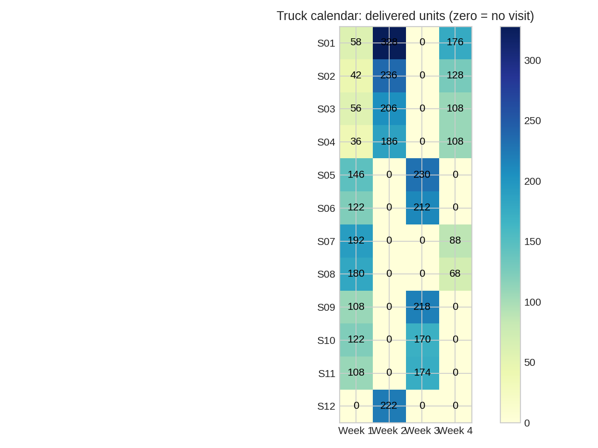
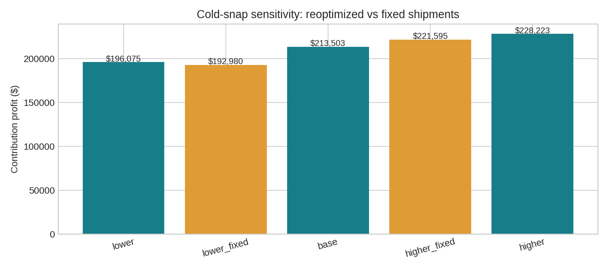

# Beacon Outfitters: Four Weeks of Replenishment

**Notebook published on GitHub.** The public notebook download is verified.
Hosted Google Colab execution remains unverified because this environment blocks Colab access.

https://colab.research.google.com/github/agrawalanshuman/beacon-outfitters-replenishment/blob/main/class_submission/Beacon_Outfitters_Midterm.ipynb

## Executive overview

Approve the four-week plan: 512 cases (4,028 units) on 27 store visits. Expected contribution profit is $213,503.10, $177,903.35 above no deliveries and $6,123.90 above the feasible forecast-driven rule.

Secure 100 additional J200 down parkas for week 1 if the incremental procurement premium is below the $10,169.20 gross gain. Use the store-specific calendar rather than a blanket every-other-week rule, which costs $3,124.00 in profit.

Academic retail replenishment case: 12 New England stores, one Worcester DC,
eight SKUs, four weeks. Team: **Anshuman, Inka, Juan Diego**. ISOM 839,
Prescriptive Analytics: Modeling & Optimization, Suffolk University,
Professor Hasan Arslan. Due November 4, 2026 at 7:40 PM Eastern.

## Run in Google Colab

Click **Open in Google Colab**, then select **Runtime → Run all**.
Use the free CPU runtime. The notebook installs exact dependency versions,
loads five public course CSVs (with embedded checksum-verified snapshots as a
fallback), solves the model, and displays shipments, financial comparisons,
charts, bottlenecks and sensitivity results. No clone, file upload, private key,
or paid subscription is needed. Allow several minutes. Read solver status and
gap: a time-limited feasible solution is not a proven optimum.

The URL owner and default branch were detected from Git origin and remote HEAD,
not the temporary local branch. Regenerate with `python scripts/build_notebook.py`.
This rebuild clears saved notebook outputs; execute it again before submission.
Published to GitHub with user authorization. No Canvas submission has been performed.

## Decisions and model

Choose integer case packs and binary truck visits. Maximize sales margin less
holding and visit costs, subject to inventory flow, demand, aggregate shelf space
**after arrival and before sales**, truck capacity and cumulative DC availability.
Unit costs appear once in margin; opening stock follows the case convention.
See [formulation](docs/formulation.md) and [assumptions](docs/assumptions.md).
Gurobi is attempted first using its bundled small-model license, with an explicit
open-source CP-SAT fallback. Both independently prove **$213,503.10**
for the base model. Currency cents and fifth-unit scaling preserve scenario
precision. See [solver evidence](results/solver_comparison.csv) for versions,
status, objective, runtime, bound and gap for every run.

## Verified findings and scenarios

| Policy | Four-week profit |
|---|---:|
| Optimized base | $213,503.10 |
| No deliveries | $35,599.75 |
| Feasible naive rule | $207,379.20 |
| Restricted alternate-week | $210,379.10 |
| Lower demand, reoptimized | $196,074.61 |
| Higher demand, reoptimized | $228,223.15 |

With weeks 3–4 demand 20% lower, replan for $196,074.61; keeping the base shipments earns $192,979.83. With demand 20% higher, replan for $228,223.15; the fixed base plan earns $221,594.99.

Base fill rate is **96.13%**, with **185 lost units**.
The feasible naive benchmark uses stable store-ID allocation and descending unit
margin priority, with all supply, shelf, truck and pack limits enforced. It is
not claimed to be the company's actual current practice. The alternate-week
scenario lets each store choose either odd or even delivery weeks. Every extra
100-unit comparison releases supply in week 1. All week 3–4 forecasts change by
±20%, with exact fractional demand; weeks 1–2 stay unchanged.

## Data sources and dictionary

Professor Arslan's [official case](https://isom-839.vercel.app/case) and
[course repository](https://github.com/harslan/isom-839), revision
`1e2b0374818759215a61475fe5eeb3af000f8263`. Original bytes are in `data/raw/`.

| CSV | Rows | Contents |
|---|---:|---|
| stores.csv | 12 | store IDs/names, shelf and truck units, visit dollars |
| skus.csv | 8 | SKU ID/name, cost/price, case-pack units, weekly holding dollars/unit |
| demand_forecast.csv | 384 | store, SKU, week, forecast units |
| opening_inventory.csv | 96 | store, SKU, opening units |
| dc_availability.csv | 32 | SKU, week, released units (unused supply carries forward) |

The notebook shows dtypes, descriptive statistics, weekly/store demand,
supply shortfalls, shelf tightness, pack sizes, margins and truck economics.
Source URLs and original files are attributed, not relicensed.

## Repository and local reproduction

- `class_submission/`: executed notebook, COO memo PDF, optional briefing deck,
  team disclosure and submission instructions.
- `src/`: loading, verification, model, baselines, scenarios and reporting.
- `data/raw/`: five unmodified official CSVs.
- `results/`: full plans, schedules, financials, scenarios, feasibility and solver evidence.
- `tests/`: manually checkable model cases, corruption detection, data and results checks.
- `docs/`: formulation, assumptions, methodology, script, verification and traceability.
- `scripts/`: reproducible notebook and executive-artifact generation.

Use Python 3.12 and `python -m pip install -r requirements.txt`.
Run the class notebook in Jupyter, or execute it with `nbclient` in a fresh kernel.
Run `python -m pytest -q` and `python scripts/build_submission.py` after
refreshing the pipeline with `run_analysis(parameters(load_data('data/raw')))`
from the corresponding `src` modules. See [methodology](docs/methodology.md).

## Verification and limitations

Independent checks recompute profit and verify every constraint family, case
integrality and visit validity. Gurobi and CP-SAT agree on the proven base
objective. The memo, slides and notebook derive their figures from one pipeline;
[verification report](docs/verification_report.md) records actual test evidence.
The published notebook download is verified; hosted Google Colab execution remains unverified.
The Word brief was absent; private Canvas rules need team confirmation.
The public website was blocked, so its official GitHub source was read instead.
No live company data, routing, forecast estimation, terminal salvage or production
deployment is claimed. Future work could investigate uncertain-demand policies
and approved routing/service requirements.

## Submission and academic integrity

See [class submission](class_submission/README.md). The team must review and
defend every constraint and rehearse the five-minute briefing. AI assistance is
disclosed in [AI_Disclosure_and_Team.txt](class_submission/AI_Disclosure_and_Team.txt).
OpenAI Codex implemented, debugged, tested and documented these artifacts;
ChatGPT planning/prompt assistance is team-reported. Published to GitHub with
user authorization; no Canvas submission was performed.

## References

- [Case and public rubric](https://isom-839.vercel.app/case)
- [Syllabus](https://isom-839.vercel.app/syllabus)
- [Session 7 data and model skeleton](https://github.com/harslan/isom-839/blob/master/public/session-07/ISOM839_Session7_Scheduling_CPSAT_and_Midterm_Case.ipynb)
- Sessions 2–6 notebooks under the course repository's `public/session-02/`
  through `public/session-06/` directories.
