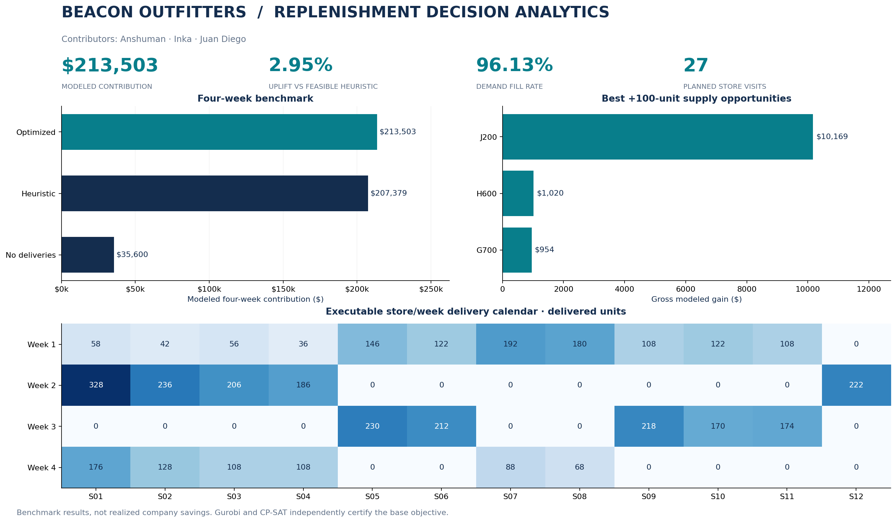

**Contributors: Anshuman · Inka · Juan Diego**

# Beacon Outfitters | Retail Replenishment Optimization

A reproducible decision-science project that converts demand forecasts and
capacity constraints into shipment recommendations, delivery schedules and
quantified inventory trade-offs.

[](https://colab.research.google.com/github/agrawalanshuman/beacon-outfitters-replenishment/blob/main/notebooks/Beacon_Outfitters_Optimization.ipynb)



## Results at a glance

| Benchmark metric | Verified result |
|---|---:|
| Four-week modeled contribution | **$213,503.10** |
| Improvement over feasible heuristic | **$6,123.90 / 2.95%** |
| Demand fill rate | **96.13%** |
| Shipment / visit plan | **512 cases · 27 visits** |
| Gross value of 100 more J200 parkas, week 1 | **$10,169.20** |

These are modeled benchmark outcomes, **not realized company savings**. The
heuristic is a specified feasible policy, not an observed business process.
All results are regenerated from one verified pipeline. Gurobi and CP-SAT
independently prove the same base objective; bounds, gaps and timings are in
[solver evidence](results/tables/solver_comparison.csv).

## Business question

Across 12 stores, eight SKUs and four weeks, how many cases should ship, where
and when? Stock is limited, shelves and trucks have finite capacity, deliveries
carry fixed costs, and demand shifts late in the planning horizon.

The model maximizes contribution: sales margin minus holding and visit costs.
Integer case packs, binary visits, inventory conservation, shared shelf space
**before sales**, truck capacity and cumulative DC releases are enforced.
Provided forecasts are inputs; this project does not train a forecasting model.
See [formulation](docs/formulation.md) and [scenario assumptions](docs/assumptions.md).

## Analysis and decision support

- Data quality: schemas, numeric precision, key grids, missingness and supply integrity.
- Benchmark evaluation: no deliveries and a feasible forecast-driven heuristic.
- Allocation: full case-level shipment plan and store/week delivery calendar.
- Marginal opportunity: separate 100-unit supply additions for every SKU.
- Uncertainty: ±20% demand in weeks 3–4, separately reoptimized and evaluated
  under the fixed base shipment policy.
- Scheduling: constrained alternating-week policy versus store-specific visits.
- Verification: independent constraint/accounting checks and two-solver agreement.

| Policy / experiment | Modeled contribution |
|---|---:|
| Optimized base | $213,503.10 |
| Feasible heuristic | $207,379.20 |
| No deliveries | $35,599.75 |
| Forced alternating-week deliveries | $210,379.10 |
| Lower demand: reoptimized / fixed shipments | $196,074.61 / $192,979.83 |
| Higher demand: reoptimized / fixed shipments | $228,223.15 / $221,594.99 |

Replanning improves lower-demand contribution by $3,094.78
and higher-demand contribution by $6,628.16.
A blanket alternating-week rule loses $3,124.00 versus the optimized calendar.
The extra-parka opportunity is gross incremental contribution before a new
procurement premium, not a supplier price or a linear-programming shadow price.

## Run in Google Colab

Open the badge, select a free CPU runtime, then **Runtime → Run all**.
The notebook installs pinned dependencies, loads five checksum-verified datasets
with embedded fallbacks, solves the experiments and displays tables and charts.
No clone, upload, private API key or paid runtime is needed.

https://colab.research.google.com/github/agrawalanshuman/beacon-outfitters-replenishment/blob/main/notebooks/Beacon_Outfitters_Optimization.ipynb

Local fresh-kernel execution is verified independently of hosted Colab
execution. See [verification](docs/verification_report.md) for current evidence
and publication status.

## Reproduce locally

```sh
git clone https://github.com/agrawalanshuman/beacon-outfitters-replenishment.git
cd beacon-outfitters-replenishment
python -m pip install -r requirements.txt
python -m beacon_outfitters --data data/raw --output results
python scripts/build_reports.py
python -m pytest -q
```

Python 3.12 is tested. Install `pip install -e .` to use the `beacon` command.
Gurobi is attempted first; its bundled small-model license handles this model.
If unavailable, the comparable integer CP-SAT implementation is used explicitly.
Time-limited solutions retain their actual status, objective bound and gap.
[Full reproduction steps](docs/methodology.md) cover notebook regeneration,
isolated execution and report reconciliation.

## Project map

```text
beacon_outfitters/  reusable validation, modeling, scenarios, reporting and CLI
notebooks/         standalone optimization notebook, EDA and solver comparison
data/raw/          five unchanged source CSVs
results/tables/    financials, shipments, shortages, scenarios and feasibility
results/plans/     complete allocations for every solved experiment
results/figures/   decision dashboard and shareable charts
reports/           decision brief PDF and analytics overview deck
scripts/           reproducible notebook/report builders and verification
tests/             small known-optimum problems and data/result checks
docs/              formulation, assumptions, provenance and AI disclosure
```

## Evidence, limitations and source credit

The pipeline records data/model SHA-256 hashes, runtime versions, random seed,
workers and scenario definitions in [run metadata](results/run_metadata.json).
[Verification](docs/verification_report.md) distinguishes tested capabilities
from unverified hosted execution. Full results include every nonzero shipment,
weekly financials, per-SKU fills and scenario decision changes.

This is deterministic benchmark analysis. Deployment would need calibrated
forecasts, supplier lead times, routing/service policies and rolling operational
validation. Margin accounting is not cash flow, and the same-input optimum is
not evidence of unbiased live business uplift.

Original benchmark data and modeling reference: **Hasan Arslan**.
[Data provenance](docs/data_provenance.md) preserves source credit, revision,
data dictionary and original hashes. Raw source files are unchanged.

**AI assistance:** ChatGPT helped with debugging and technical explanations;
OpenAI Codex assisted implementation, testing, documentation and artifact
creation. Contributors remain responsible for reviewing the work.
[Full disclosure](docs/AI_DISCLOSURE.md).

## Explore and share

- [Standalone notebook](notebooks/Beacon_Outfitters_Optimization.ipynb)
- [Decision brief](reports/Beacon_Outfitters_Decision_Brief.pdf)
- [Analytics overview deck](reports/Beacon_Outfitters_Analytics_Overview.pptx)
- [LinkedIn post draft and posting steps](docs/linkedin_post.md)
